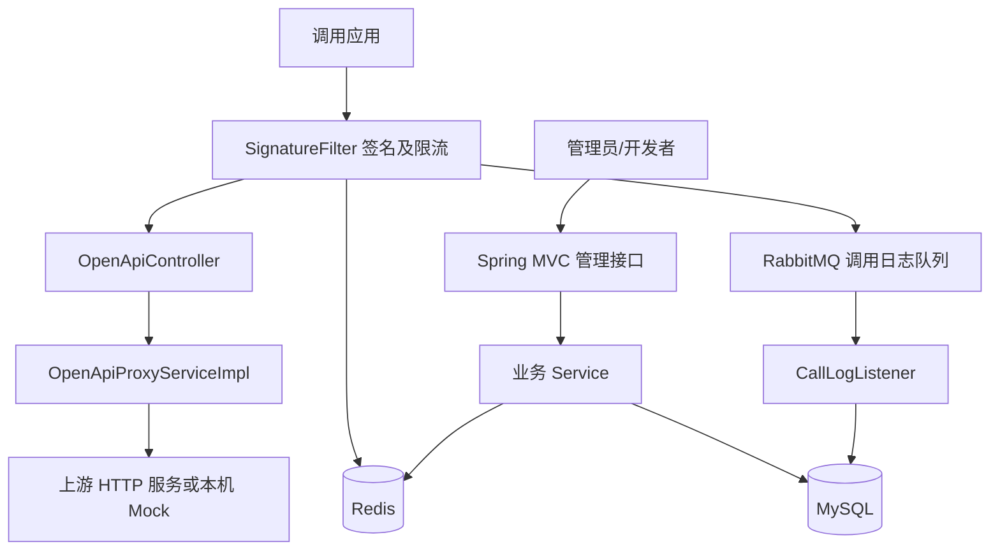

# 运行环境与总体架构

[返回学习导航](learning-guide.md)

## 1. 项目解决什么问题

假设你有天气、订单、用户查询三个 HTTP 服务，希望让其他应用调用，又不能让任何人无限制访问。AgentGate 让管理员登记 API，开发者创建应用取得 AppKey/AppSecret，申请订阅并获得审批。调用时平台验证签名、检查权限和额度，再请求真正的上游，返回结果并记录调用。

这里的“智能体工具”本质是 HTTP API。项目没有大模型推理或 Agent 编排。后端是一个 Maven 模块、一个 Spring Boot 进程，不是 Spring Cloud 微服务网关；独立的 Nginx 演示前端见 [前端运行说明](frontend-demo.md)，也可用命令行或接口客户端操作。

## 2. 总体架构

| 组件 | 在本项目中的工作 | 新手应理解的概念 |
| --- | --- | --- |
| Spring Boot / MVC | 启动 Web 服务、接收和返回 HTTP | 框架负责接线，业务类负责规则 |
| MyBatis-Plus / MySQL | 保存用户、应用、API、订阅和日志 | Mapper 接口由框架生成实现；数据库最终约束数据 |
| Redis / Lettuce | 登录态、鉴权缓存、Nonce、限流、配额 | 内存数据有 TTL，不能当永久数据库 |
| Redisson | 缓存重建时竞争分布式锁 | 与 Lettuce 共用 Redis，但承担不同职责 |
| RabbitMQ | 请求完成后异步保存调用日志 | 生产者发送，消费者稍后处理，有时间差 |
| Jackson / Bean Validation | JSON 转换、DTO 参数校验 | `@Valid` 才会触发请求参数验证 |
| Lombok / Hutool / AOP | 构造器与访问器、工具方法、管理审计 | 注解减少样板代码，不意味着业务自动实现 |

### 分层读法

`Controller → Service 接口 → ServiceImpl → Mapper → MySQL`。Controller 接收参数，ServiceImpl 判断归属、状态和业务条件，Mapper 执行数据库操作。DTO 是请求或返回的数据形状，Entity 对应数据库记录。不要把 HTTP 方法、Java 方法、SQL 操作混为一谈。

`@SpringBootApplication` 开启自动配置和组件扫描；`@MapperScan` 扫描 Mapper。`@Component`、`@Service`、`@Configuration` 注册 Spring 对象。`@RequiredArgsConstructor` 为 `final` 依赖生成构造器，Spring 自动注入对应对象。接口本身不执行逻辑，具体执行的是容器中的实现类。

## 3. 从零启动

准备 JDK 8、Maven 3.6+ 和 Docker Desktop。执行 `docker compose up -d` 启动 MySQL 8、Redis 7 和 RabbitMQ 3.13，详见 [Docker 依赖服务](docker-services.md)。

1. 首次创建 MySQL 数据卷时，Compose 自动挂载并执行 `src/main/resources/db/agentgate.sql`，无需手动导入。已有数据卷不会重复初始化。
2. 执行 `docker compose up -d`，检查 `docker compose ps` 中三个服务为 healthy；需要自定义账号时复制 `.env.example` 为 `.env`。
3. 若修改 `.env` 密码，在启动后端前同步设置 `DB_PASSWORD`、`REDIS_PASSWORD`、`RABBITMQ_USERNAME`、`RABBITMQ_PASSWORD` 环境变量。
4. 执行 `mvn test` 检查现有单元测试，然后 `mvn spring-boot:run`。或 `mvn clean package` 后执行 `java -jar target/agentgate-1.0.0-SNAPSHOT.jar`。
5. 执行 `curl.exe http://127.0.0.1:8081/actuator/health`。Windows PowerShell 用 `curl.exe` 可避开别名差异。

启动时 JVM 进入 `AgentGateApplication.main`，Spring 建立容器，创建 Redis/Redisson、RestTemplate、MyBatis、RabbitMQ 等对象，注册过滤器和 MVC 拦截器。`RateLimitServiceImpl.init` 加载 Lua 资源；`DataInitializer.run` 在启动阶段依次补齐管理员、套餐和演示 API。SQL 表必须已存在。RabbitMQ 监听容器启动后等待消息。

默认管理员是 `admin/admin123`。初始化器只在记录不存在时创建，修改管理员环境变量不会自动修改已有用户密码。演示 API 指向本机 `/mock-api`，因此本地允许 loopback；生产应关闭并配置真实上游。

