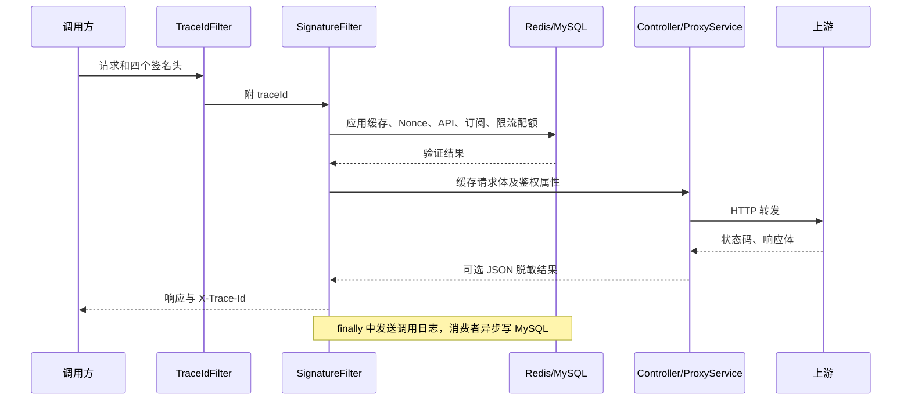

# 身份认证与完整请求链路

[返回学习导航](learning-guide.md)

除本篇贯穿的 Mock 示例外，项目启动还登记 weather_live（Open-Meteo）与 exchange_rate（Frankfurter）。它们走完全相同的签名、订阅、额度、代理和日志链路，只是上游为公网 HTTPS。参数、来源及限制见 [真实 API 接入](public-apis.md)。

## 4. 两种身份，不能混用

### 4.1 人登录平台：Redis Token

`UserController.register → UserServiceImpl.register`：检查重名，BCrypt 加盐哈希密码，以 DEVELOPER 身份保存；数据库用户名唯一索引处理并发重名。登录通过 `BCrypt.checkpw` 验证，生成 UUID Token，将用户 ID、昵称、角色写入 Redis Hash，有效期 120 分钟。

客户端随后带 `Authorization: Bearer <token>`。`RefreshTokenInterceptor.preHandle` 读 Redis，恢复 `UserDTO` 到 `UserHolder` 的 ThreadLocal，并续期。无 Token 时它仍放行，因为是否必须登录由下一层决定。`LoginInterceptor` 对受保护路径检查用户存在，对 `/admin/` 检查 ADMIN 角色。`MvcConfig` 排除登录、注册、开放 API、Mock 和健康接口。

ThreadLocal 可理解为“当前请求线程的用户便签”。线程池会复用线程，因此 `afterCompletion` 必须清理；不能直接用它向消息消费线程传递身份。登出删除 Redis Token，后续请求失效。现有 Token 中角色来自缓存，修改数据库角色不会自动同步所有会话。

### 4.2 应用调用工具：AK/SK 签名

`AppServiceImpl.create` 生成 AppKey 和 Secret，Secret 经 AES-GCM 加密存数据库，创建及重置时返回明文。应用归属由 `getOwnedApp` 对比当前用户 ID，不能仅因为登录就访问别人的 appId。

`getAuthInfo` 从数据库解密 Secret 并放入 Redis 鉴权缓存，故 Redis 中存在明文 Secret；数据库加密并不等于端到端无明文。重置、禁用和白名单修改后删除对应缓存。主密钥由配置字符串 SHA-256 派生为 AES 密钥，随机 12 字节 IV 与密文、认证标签一起 Base64 保存；BCrypt 用于不可逆验密码，AES 用于可逆取回签名密钥，两者目的不同。

## 5. 一次开放调用完整经过哪些代码

例：`GET /openapi/weather?city=beijing`。先通过平台接口创建应用、订阅 weather、管理员审批；仅创建应用还不能调用。接口样例见 [api.md](api.md)，完整操作步骤见 [前后端启动与页面使用](frontend-demo.md)。



1. `TraceIdFilter` 最先生成 traceId，写入 request attribute、响应头与 MDC；结束后清理 MDC。MDC 是线程日志上下文，不是分布式追踪系统。
2. `SignatureFilter` 仅处理 `/openapi/` 前缀，使用 `CachedBodyHttpServletRequest` 缓存请求流，限制请求体默认 1 MiB。Servlet 输入流通常只能读一次，缓存后签名验证和后续转发才可重复读取同一批字节。
3. 要求 `X-App-Key`、`X-Timestamp`、`X-Nonce`、`X-Signature`。时间戳为秒，默认容差 ±300 秒；查询应用状态及 IP 白名单。
4. `SignatureUtils` 解码查询串，按 key/value 排序后编码为规范查询串；原始请求体做 SHA-256。签名串是 `METHOD + 换行 + PATH + 换行 + Query + 换行 + timestamp + 换行 + nonce + 换行 + bodyHash`。用 Secret 做 HMAC-SHA256，采用常量时间比较。
5. 签名成功后才用 Redis `SETNX + TTL` 消费应用级 Nonce，默认保留 5 分钟。签名正确也不能复用同一个 Nonce。JSON 空格或字段顺序变化会改变原始字节哈希；客户端必须签署实际发送的内容。
6. 从路径第一段提取 API code，检查 API 上架、订阅 ACTIVE、套餐存在，执行限流和额度扣减。鉴权结果通过 request attribute 传给 Controller。
7. `OpenApiController.forward → OpenApiProxyServiceImpl.forward` 检查方法，再校验上游 URL，将剩余路径和原始 query 拼接到登记的地址。只复制 Content-Type、Accept、User-Agent，加上 traceId；不把所有客户端头或 AK/SK 传给上游。
8. RestTemplate 同步等待上游；全局连接超时 3 秒、读取超时 5 秒，不跟随重定向、不继承系统代理。上游 4xx/5xx 正常返回，由调用方收到其状态；网络异常由 Controller 转为上游错误或超时。
9. 敏感级别 ≥2 且 Content-Type 含 JSON 时递归脱敏。最终超出上限的响应体会被截断。`ProxyResponse` 承载状态、类型和字节；成功代理响应不额外套 `Result`。
10. Filter 的 finally 取耗时、状态、请求/响应大小、已识别 appId/apiId 构造 `CallLogMessage`，将缓存响应复制回真正响应并发起日志保存。失败鉴权也记录，尚未识别的应用或 API ID 可以为空。


## 6. 调用前的业务准备：四种记录怎样建立

下面以开发者调用天气 API 为例。用户 ID、应用 ID、API ID 和订阅 ID 是不同对象，不能混用。页面的个人应用序号仅供展示，请求实际使用数据库主键。

### 6.1 注册与登录

入口代码是 `UserController.register/login`，核心实现是 `UserServiceImpl.register/login`。

注册先查用户名，BCrypt 加盐哈希密码，设置 `UserRole.DEVELOPER` 与 `UserStatus.ACTIVE`，插入 `tb_user`；捕获唯一键冲突防止两个请求同时通过查重。登录先查用户，再验证密码与用户状态；生成 UUID Token，把 id、username、nickname、role 写入 `login:token:{token}`。返回 `LoginResultDTO`，实际字段是 `data.token` 和 `data.userDTO`。

管理请求带 Authorization 后，MVC 链路为：

```text
RefreshTokenInterceptor.preHandle：读 Redis → UserHolder.saveUser → 续期
LoginInterceptor.preHandle：检查登录 → /admin/ 检查 ADMIN
Controller → Service → Mapper
RefreshTokenInterceptor.afterCompletion：removeUser
```

注意：`/openapi/**` 不走 LoginInterceptor 强制登录，但 RefreshTokenInterceptor 仍注册在全路径。调用开放接口不需要发送用户 Token；用户登录也不会替代签名。

### 6.2 创建应用

`DeveloperAppController.create → AppServiceImpl.create → AppMapper.insert`：

```java
Long userId = requireUserId();
String appKey = "ak_" + RandomUtil.randomString(16);
String appSecret = RandomUtil.randomString(32);
// 应用实体还会设置名称、所有者、ACTIVE 和 IP 白名单。
app.setAppKey(appKey);
app.setAppSecretCipher(AesUtils.encrypt(appSecret, secretKey));
```

AK 是查询应用的标识；SK 是客户端计算 HMAC 的密钥；secretKey 是平台保护数据库 SK 的 AES 主密钥。AK 可随请求发送，SK 不应随普通调用发送，平台主密钥不发给用户。创建和重置才返回明文 SK。当前鉴权缓存中保存解密后的 SK，需要保护 Redis。

### 6.3 登记 API 和维护套餐

管理员通过 `AdminApiController.create` 登记 code、method、upstreamUrl、sensitivityLevel 等。`ApiServiceImpl.create` 检查 code 重名、执行 SSRF 地址校验，保存为 DRAFT；`publish → transition` 按枚举判断并执行带旧状态的条件更新，之后清理 code 缓存。已有示例 weather 由 `DataInitializer` 创建为 PUBLISHED，上游是本机 `/mock-api/weather`。

`AdminQuotaPlanController → QuotaPlanServiceImpl` 保存 QPS、日额度和月额度；DTO 正数约束在入口 Valid 触发。套餐 ID 会保存在订阅上，调用时再查套餐。API 的 timeoutMs 虽可登记，实际转发仍使用 RestTemplate 的全局超时。

### 6.4 申请与审批

`DeveloperSubscriptionController.apply → SubscriptionServiceImpl.apply` 依次执行：

1. `appService.getOwnedApp(appId)`：应用存在且属于当前用户；不等于检查应用已启用。
2. `apiService.getById(apiId)` 并要求 PUBLISHED。
3. `quotaPlanService.getById(quotaPlanId)`：套餐存在。
4. `findOne(appId, apiId)`：无记录则插入 PENDING；联合唯一索引阻止同应用同 API 重复创建。
5. 已有 REJECTED 则使用 `WHERE id=? AND status='REJECTED'` 改回 PENDING，替换套餐、清空拒绝原因、手动设置更新时间；零行表示条件已不匹配。
6. PENDING/ACTIVE 再次申请直接拒绝；成功分支删除订阅缓存。

管理员的 `approve` 只处理 PENDING，通过设 ACTIVE，拒绝设 REJECTED；SQL 再次限定旧状态，避免并发审批互相覆盖。方法事务在通过 Spring 代理调用时生效；Redis 删除不随数据库回滚，也没有强一致保证。管理写操作还经过 AuditLogAspect，记录操作人、动作、参数摘要和 IP。

## 7. 客户端实际发送什么

浏览器 `nginx/html/app.js` 的 `runner` 使用 Web Crypto；Apifox 使用 `docs/apifox/sign-request.js`。经 Nginx 时浏览器请求 `/api/openapi/weather?city=beijing`，代理去除 `/api`，服务端收到 `/openapi/weather?city=beijing`。

```http
GET /openapi/weather?city=beijing HTTP/1.1
X-App-Key: 创建应用返回的AK
X-Timestamp: 当前Unix秒
X-Nonce: 每次请求新生成的随机值
X-Signature: HMAC计算得到的小写十六进制
```

签名原文包含六段，以真实换行连接，无额外结尾换行：

```text
GET
/openapi/weather
city=beijing
当前Unix秒
本次Nonce
空请求体的SHA256
```

`SignatureUtils.parseQueryString → buildQueryString` 保留重复参数，按键和同键值排序，用 UTF-8 Java URLEncoder 编码；空格为 `+`。PATH 不含 query 或 Nginx 前缀。POST 的 body 按实际字节计算 SHA-256，不能签名后再调整 JSON 格式。时间戳、Nonce 与签名必须一起更新。

## 8. 服务端每一站的输入、输出与副作用

| 顺序 | 实际业务代码 | 输入与判断 | 输出或副作用 |
| --- | --- | --- | --- |
| 1 | TraceIdFilter.doFilterInternal | 任意 HTTP 请求 | 新 traceId 写 MDC、request 和响应头，结束清理 MDC |
| 2 | SignatureFilter.doFilterInternal | URI 是否以 contextPath+/openapi/ 开头 | 非开放请求直接放行；开放请求开始计时并包装响应 |
| 3 | CachedBodyHttpServletRequest 构造器 | 原始输入流与默认 1 MiB 上限 | 缓存字节、记录超限标志；超限拒绝 |
| 4 | requireHeader、时间戳分支 | 四个头非空、秒级时间可解析且在 ±300 秒 | 失败抛 BizException，不继续后续业务 |
| 5 | AppServiceImpl.getAuthInfo | AK 查询缓存/数据库 | 返回 AppAuthInfo，含解密 SK；未知 AK 拒绝 |
| 6 | AppStatus 与 IpUtils | 应用 ACTIVE、来源 IP 匹配白名单 | 默认用 TCP 来源；信任代理需显式配置 |
| 7 | SignatureUtils | 原始 body、路径、query、头信息及 SK | 计算 expected，与传入签名常量时间比较 |
| 8 | StringRedisTemplate.setIfAbsent | nonce:应用AK:Nonce，带 5 分钟 TTL | 首次写入成功才继续；签名失败不会占用 Nonce |
| 9 | resolveApiCode、getPublishedByCode | 从 /openapi/ 后第一段查 API | 要求记录存在且已发布，得到 apiId 与上游配置 |
| 10 | SubscriptionServiceImpl.getActive | appId+apiId 查询 ACTIVE 订阅 | 得到 quotaPlanId；不存在拒绝 |
| 11 | QuotaPlanServiceImpl.getById | 套餐主键 | 获取调用限额，套餐不存在拒绝 |
| 12 | RateLimitServiceImpl.checkAndConsume | appId、API、套餐 | 一次 Lua 原子扣减 QPS 令牌与日/月配额 |
| 13 | request.setAttribute | appId、完整 API 对象、traceId、clientIp | 传给后续 Controller，无需重新验签查询 |
| 14 | filterChain.doFilter | 缓存请求及响应包装 | 进入 MVC，最终返回到 Filter，而不是结束整个方法 |
| 15 | OpenApiController.forward | 从 attribute 取鉴权结果 | 调代理服务、处理网络异常，构造 ResponseEntity |
| 16 | OpenApiProxyServiceImpl.forward | 请求方法、API 配置、body | 校验方法和 URL、构造上游请求、同步等待响应 |
| 17 | MaskUtils.maskJson | JSON 且敏感级别至少 2 | 按字段名递归掩码，不匹配或解析失败保留原文 |
| 18 | SignatureFilter 的返回与 finally | HTTP 状态与响应字节 | 拷贝真正响应，发送调用日志快照 |
| 19 | CallLogListener → saveDirect | MQ 消息 | 幂等入日志、累计用量、成功 ACK 或失败进死信 |

### 8.1 缓存命中与未命中

`getAuthInfo`、`getByCode`、`getActive` 都使用 `CacheClient.getOrLoad`：先 get；命中返回；有空值标记返回 null；未命中争抢 Redisson 锁；获得锁后二次检查再调用 loader 查 MySQL；结果写 JSON 或空值标记，finally 释放锁。普通 TTL 带抖动。未获得锁的线程短等后仍可能回源，不能理解为数据库永远只被查一次。

### 8.2 一次 Lua 的合并扣减

`checkAndConsume` 构造 `ratelimit:appId:apiId`、`quota:day:...:yyyyMMdd`、`quota:month:...:yyyyMM` 三个 key，一次调用 `rate_limit_consume.lua`：先读 Hash 中 tokens/last，按时间差补令牌并封顶；令牌不足返回 0 并抛 RATE_LIMITED。之后读日/月计数，任一达上限返回 -1/-2 并抛 QUOTA_EXCEEDED；全部通过才扣令牌、两个计数各加一并设置 TTL，返回 1。

所有判断在写入之前，拒绝路径不修改任何 key；脚本在 Redis 单线程内原子执行，QPS 与日/月配额要么一起扣、要么都不扣。脚本之后的路径（方法校验、SSRF、上游失败）仍不退额度。配额表示在当前校验点消耗的调用次数，不是成功调用计费。Nonce 同样已消耗，失败后重试要重新签名。

### 8.3 代理和响应怎样构造

`forward` 先检查登记 method（ANY 不限制），再次执行 `SsrfUtils.validate`；`buildTargetUrl` 去掉 `/openapi/{code}` 后追加剩余路径和原始 query。例如 `/openapi/order/1001` 转为登记 `/mock-api/order` 加 `/1001`。

`copyHeader` 只带 Content-Type、Accept、User-Agent，再带 X-Trace-Id。`readBody` 优先取已缓存字节。`RestTemplate.exchange` 在当前线程同步调用，上游在本机 Mock 时会再形成一个独立 HTTP 请求，有自己的过滤和 traceId；Mock 路径不参与开放鉴权。

RestTemplate 禁重定向并直连，上游 4xx/5xx 不抛 HTTP 状态异常。敏感 JSON 可被 MaskUtils 改写；超过 maxBodyBytes 的结果最终截断，可能不再是合法 JSON，而且是在响应已读入内存后截断，不是流式内存上限。

Controller 仅设置上游 Content-Type、状态与 byte[]，不是无差别透传所有响应头。响应体不额外包装 Result。Filter 用 ContentCachingResponseWrapper 获取大小并最终 copyBodyToResponse，遗漏这一步可能导致调用方收不到缓存内容。

## 9. 失败分支与日志是如何闭环的

### 9.1 两套异常处理入口

签名 Filter 自己 catch BizException，映射 HTTP 状态并写 Result；其他异常记日志后返回通用 500。MVC 内 Service 抛出的 BizException 由 WebExceptionAdvice 处理，Filter 返回后对 HTTP≥400 的 JSON 尝试提取 code。上游非 Result 原始响应的业务码通常为空。

OpenApiController 将 ResourceAccessException 根据直接 cause 是否 SocketTimeoutException 区分超时和访问失败；其他 RestClientException 统一为 UPSTREAM_ERROR。它不是根据所有可能嵌套异常逐层判断。

| 失败点 | HTTP / code | 后续不再执行的部分 |
| --- | --- | --- |
| 请求体过大 | 413 / 413 | 签名及后续链路 |
| 缺头/时间戳/签名/重放 | 401 / 1001～1004 | API 转发；具体已识别信息随失败位置不同 |
| 应用禁用/IP 不符 | 403 / 1005、1006 | 验签及后续链路 |
| API 下架/未订阅 | 403 / 1007、1008 | 扣减与上游调用 |
| QPS/配额不足 | 429 / 429、4290 | 上游调用 |
| 方法不符/危险地址 | 405 / 405 或 403 / 1009 | 上游请求，此时已扣额度 |
| 上游超时/连接失败 | 504 / 2001 或 502 / 2002 | 正常响应转换 |

### 9.2 finally、消息、数据库事务

通常无论成功失败，SignatureFilter 的 finally 都会取响应大小、复制响应，再构造 CallLogMessage。appId 在应用被识别后才赋值，apiId 在 API 成功查询后才赋值，因此早期拒绝日志可能没有这些 ID。耗时不包含随后 MQ 发送和消费时间。需要注意，当前 copyBodyToResponse 位于日志发送前，若该方法自身抛异常，后面的日志步骤也可能无法执行，不能保证任何失败都必有日志。

`CallLogDispatchServiceImpl.asyncSave` 调 RabbitTemplate.convertAndSend；抛异常才通过 `CallLogService` 的 Spring 代理同步 `saveDirect`，兜底也失败仅记录错误。它没有通过发布确认完成端到端保证，也不是 Java 异步方法。

正常消费者 `CallLogListener.onMessage` 从 Spring 代理调用 saveDirect：

```text
@Transactional saveDirect
  → CallLogMapper.insertIgnore：trace_id 唯一，重复返回 0 后直接结束
  → 新记录且 appId/apiId 非空：UsageStatMapper.upsertIncrement
  → 事务提交后返回消费者
  → basicAck(deliveryTag, false)
```

统计 SQL 依赖 `(app_id, api_id, stat_date)` 唯一键做原子累加；statusCode≥400 才增加错误数，而看板成功数只计 2xx，3xx 两边都不算错误/成功。日志 createTime 和统计日期取落库时刻，跨日积压可能归到消费当天。

消费者异常执行 basicNack(requeue=false)，消息按 RabbitMQConfig 的死信绑定进入死信队列，没有现成自动补偿消费者。同步兜底由发送服务跨 Bean 调用 `CallLogService.saveDirect`，事务代理生效；但发送成功不等于消费者已落库，当前方案仍是防重复和尽力留痕，不是严格 exactly-once。

## 10. 对照源码阅读与断点清单

下列完整源码均为业务处理链路的一部分；接口层、工具层、SQL 与消息配置不能漏读。

| 场景 | 源码阅读入口 |
| --- | --- |
| 登录、应用、API、套餐、订阅、日志与看板 Service | [业务接口与实现](source-walkthrough/04-services.md) |
| Filter、Interceptor、审计切面 | [请求安全链路](source-walkthrough/02-request-security.md) |
| 用户、开发者、管理员、开放与 Mock Controller | [HTTP 入口](source-walkthrough/03-controllers.md) |
| 密码之外的 AES、HMAC、请求体缓存、IP/SSRF、缓存、脱敏 | [公共工具完整源码](source-walkthrough/06-utils.md) |
| Entity、DTO、Mapper SQL 与状态枚举 | [数据模型与数据库访问](source-walkthrough/05-models-data.md) |
| MVC、RestTemplate、MyBatis、MQ、Redisson 与初始化 | [启动配置](source-walkthrough/01-entry-config.md) |
| Lua、配置、数据库唯一索引和建表语句 | [资源与构建](source-walkthrough/08-resources-build.md) |

推荐调试：先在 SubscriptionServiceImpl.apply/approve 完成准备；再在 SignatureFilter、AppServiceImpl.getAuthInfo、CacheClient.getOrLoad、RateLimitServiceImpl.checkAndConsume、OpenApiProxyServiceImpl.forward、CallLogListener.onMessage 停下，观察 request attribute、Redis key、SQL 行数与 traceId。消费发生在另一个线程，不要期待 UserHolder 中仍有登录用户。

完整代码快照便于离线阅读，最新实现请直接打开对应 src 文件；新增方法或改名时同步更新说明。Apifox 的实际测试用例与签名前置脚本见 [测试指南](apifox/README.md)。
